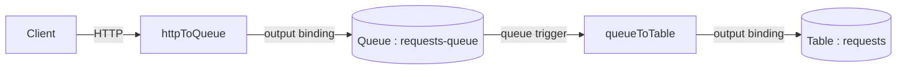

# TP Cloud – Architecture Serverless avec Azure Functions (en local)

Projet réalisé dans le cadre du cours de Cloud (MBA 2).

L'objectif du TP est de découvrir le serverless en mettant en place une petite architecture événementielle avec Azure Functions. Tout tourne en local : on n'utilise pas de compte Azure, le stockage (Queue et Table) est simulé avec l'émulateur Azurite.

J'ai choisi de faire le projet en **Node.js** (modèle de programmation v4 d'Azure Functions).

## Architecture

L'application est composée de deux fonctions qui ne se connaissent pas entre elles. Elles communiquent seulement à travers une queue :

```
Requête HTTP ──> [httpToQueue] ──> Queue "requests-queue" ──> [queueToTable] ──> Table "requests"
```



Le principe :

1. on appelle la fonction HTTP avec des données ;
2. elle dépose un message dans la queue et répond tout de suite ;
3. l'arrivée du message dans la queue déclenche automatiquement la deuxième fonction ;
4. la deuxième fonction enregistre les données dans la table.

L'intérêt de passer par une queue, c'est que les deux fonctions sont découplées. Si la deuxième fonction plante ou est lente, la première continue de répondre et les messages attendent dans la queue.

## Les fonctions

### 1. `httpToQueue` (HTTP Trigger)

Fichier : `src/functions/httpToQueue.js`

C'est le point d'entrée de l'application, accessible sur `http://localhost:7071/api/httpToQueue`.

- Avec un `POST`, elle récupère le corps JSON de la requête. Avec un `GET`, elle récupère les paramètres de l'URL.
- Elle construit un message contenant un `id`, la date de réception et les données reçues.
- Elle envoie ce message dans la queue `requests-queue` grâce à un binding de sortie `storageQueue`.
- Elle renvoie un code `202` avec l'id du message, ou un `400` si aucune donnée n'a été envoyée.

La fonction est stateless : elle ne garde rien en mémoire et ne fait aucun traitement métier.

### 2. `queueToTable` (Queue Trigger)

Fichier : `src/functions/queueToTable.js`

- Elle est déclenchée automatiquement dès qu'un message arrive dans `requests-queue`.
- Elle lit le message et le transforme en entité pour la Table Storage. La `PartitionKey` vaut `requests`, la `RowKey` est l'id du message, et chaque donnée reçue devient une colonne.
- Elle écrit l'entité dans la table `requests` grâce à un binding de sortie `table`.

Elle n'appelle jamais la fonction HTTP et ne dépend pas d'elle. Elle traite n'importe quel message qui arrive dans la queue.

Les deux fonctions n'utilisent que des triggers et des bindings, sans SDK de stockage. La queue et la table sont créées automatiquement au premier passage.

## Prérequis

- Node.js (testé avec la version 22)
- Azure Functions Core Tools v4, à vérifier avec `func --version`
- Azurite, en extension VS Code ou installé avec `npm install -g azurite`
- Extensions VS Code utilisées : Azure Functions, Azure Tools, Azurite

Sous Windows, j'ai installé les Core Tools avec :

```powershell
winget install --id Microsoft.Azure.FunctionsCoreTools -e
```

> Remarque : après l'installation, il faut fermer complètement VS Code et le relancer, sinon la commande `func` n'est pas reconnue dans le terminal.

## Lancer le projet

**1. Cloner le projet et installer les dépendances**

```powershell
git clone https://github.com/MaxOuvrard/MBA-cloud.git
cd MBA-cloud
npm install
```

**2. Démarrer Azurite** (dans un premier terminal)

```powershell
azurite --location .azurite --debug .azurite/debug.log
```

On peut aussi utiliser l'extension VS Code : `Ctrl+Shift+P` puis `Azurite: Start`.

Azurite est prêt quand les 3 services sont lancés (Blob sur 10000, Queue sur 10001, Table sur 10002).

**3. Démarrer les fonctions** (dans un deuxième terminal)

```powershell
func start
```

Les deux fonctions doivent apparaître :

```
Functions:
        httpToQueue: [GET,POST] http://localhost:7071/api/httpToQueue
        queueToTable: queueTrigger
```

Le fichier `local.settings.json` est volontairement versionné. Il contient seulement `AzureWebJobsStorage = UseDevelopmentStorage=true`, ce qui permet aux fonctions d'utiliser Azurite. Il n'y a donc aucun secret dedans.

## Tester

Dans un troisième terminal :

```powershell
Invoke-RestMethod -Method Post -Uri http://localhost:7071/api/httpToQueue -ContentType "application/json" -Body '{"client":"Alice","montant":42}'
```

Ou bien avec curl :

```bash
curl -X POST http://localhost:7071/api/httpToQueue -H "Content-Type: application/json" -d '{"client":"Alice","montant":42}'
```

On reçoit en réponse quelque chose comme :

```json
{ "status": "queued", "id": "c3ceb600-caeb-4bd3-ae35-1c37b83a341c" }
```

Dans les logs de `func start`, on voit l'enchaînement des deux fonctions :

```
Executing 'Functions.httpToQueue' ...
Message c3ceb600-... publié dans requests-queue
Executed 'Functions.httpToQueue' (Succeeded, ...)
Executing 'Functions.queueToTable' (Reason='New queue message detected on 'requests-queue'.', ...)
Message c3ceb600-... reçu depuis requests-queue
Entité c3ceb600-... écrite dans la table requests
Executed 'Functions.queueToTable' (Succeeded, ...)
```

Pour vérifier les données, j'ai utilisé l'onglet Azure de VS Code (ou Azure Storage Explorer), dans la partie **Local Emulator** :

- la queue `requests-queue` est vide, parce que le message a été consommé par la deuxième fonction ;
- la table `requests` contient une ligne par appel, avec les colonnes `client`, `montant` et `receivedAt`.

## Organisation du projet

```
├── src/functions/
│   ├── httpToQueue.js      -> fonction HTTP Trigger
│   └── queueToTable.js     -> fonction Queue Trigger
├── host.json               -> config du runtime Azure Functions
├── local.settings.json     -> config locale (connexion à Azurite)
├── package.json
└── README.md
```

## Difficultés rencontrées

- La commande `func` n'était pas reconnue dans le terminal de VS Code juste après l'installation. Il a fallu redémarrer complètement VS Code pour qu'il prenne en compte le nouveau PATH.
- J'ai eu une erreur `EADDRINUSE` au lancement d'Azurite, parce qu'une autre instance tournait déjà sur les mêmes ports (10000 à 10002). Il ne faut en lancer qu'une seule : soit l'extension, soit la ligne de commande.
- La Table Storage n'accepte que des valeurs simples (texte, nombre, booléen...). Les objets imbriqués éventuels sont donc convertis en texte JSON avant l'écriture.
